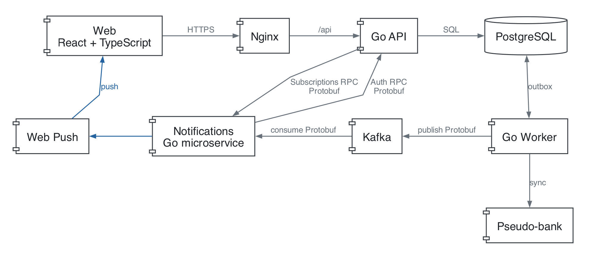

# Архитектура

Пересборка схемы из корня с Graphviz: `dot -Tpng docs/diagrams/architecture.dot -o docs/diagrams/architecture.png`.

На backend реализованы регистрация и вход по email/паролю, JWT-сессии, демо Web Push и ручной импорт CSV T-Bank с сохранением операций. Есть базовые таблицы `users`, `auth_sessions`, `ledger_periods`, `audit_log`, `imports` и `operations`. Остальные финансовые модули ниже описывают план.

## Стек

- Межсервисные контракты: Protobuf, генерация Go-сообщений и Connect RPC через Buf.
- Backend: Go, `net/http`, PostgreSQL, pgx, sqlc, goose.
- Фоновые задачи: worker публикует outbox; импорт CSV выполняется синхронно в API.
- Документация: OpenAPI генерируется из Go-аннотаций; API отдаёт Swagger UI по `/swagger/`, nginx проксирует этот путь.
- Push-уведомления: отдельный Go-сервис `notifications`, Kafka через franz-go, Web Push.
- Frontend: React, TypeScript, Vite, CSS, `fetch`.
- Локальный запуск: Docker Compose; nginx раздаёт frontend и проксирует `/api/`.

Проект состоит из одного Go-модуля и трёх отдельных процессов: API, worker и `notifications`.

API обрабатывает пользовательские запросы, worker публикует события в Kafka, а `notifications` независимо отправляет push-уведомления.

Основные модули backend: пользователи, бюджет, операции, правила, цели и уведомления. Источник банковских операций на первом этапе — ручная загрузка CSV T-Bank.

SQL сервисов хранится в `backend/queries/`, отдельно для API, outbox и notifications. sqlc генерирует типизированные методы pgx в `backend/internal/db/` по goose-миграциям. Транзакциями управляют сервисы, передавая `pgx.Tx` в сгенерированный пакет.

Начальные миграции `004_init.sql` и `notifications/003_init.sql` создают актуальную схему на чистой базе. Первая создаёт схемы и роли, вторая создаёт таблицы сервиса notifications. Истории Goose независимы. Последующие изменения добавляются отдельными миграциями.

## Межсервисные контракты

Единственный источник схем — [`proto/smartbudget/services/v1/contracts.proto`](../proto/smartbudget/services/v1/contracts.proto). `make proto` генерирует сообщения Protobuf и клиенты/обработчики Connect Go в `backend/internal/gen/`; `make generate` включает этот шаг. Генераторы закреплены в `scripts/proto.Dockerfile`. CI через `make check-generated` проверяет lint, форматирование `.proto` и отсутствие расхождений с результатом генерации.

| Вызов | Отправитель → получатель | Контракт |
| --- | --- | --- |
| Создать/обновить подписку | API → notifications | `SubscriptionsService.UpsertSubscription` |
| Удалить свою подписку | API → notifications | `SubscriptionsService.DeleteSubscription` |
| Проверить сессию | notifications → API | `AuthService.CheckSession` |
| Запросить push | worker → Redpanda → notifications | `NotificationRequested` |

Синхронные вызовы используют Connect RPC с бинарным Protobuf на существующих HTTP-серверах порта 8080. Генерируемые обработчики подключены к `net/http`; новые порты не нужны. Клиент передаёт контекст и ограничивает RPC тремя секундами. В запросе подписки user ID, session ID и срок сессии берутся из проверенной авторизации API, а не из браузерных заголовков. Notifications проверяет владельца подписки и входные данные. Ошибки RPC преобразуются во внешние HTTP-ответы 400/409/503.

Каждый RPC защищён служебным Bearer-токеном `NOTIFICATIONS_TOKEN`, проверяемым interceptor. Эти маршруты не зависят от браузерной CSRF-проверки и не публикуются nginx, который проксирует `/api/` и `/swagger`. Внешний REST/JSON API и Web Push провайдеру используют свои клиентские форматы.

Совместимые изменения добавляют поля с новыми номерами. Номера и имена удалённых полей следует объявлять `reserved`; менять смысл или тип существующего поля нельзя. Несовместимые изменения требуют новой версии контракта и согласованного перехода производителей и потребителей.

## Авторизация

Пароли хранятся как bcrypt-хеши (cost 12). Email нормализуется в нижний регистр без крайних пробелов и защищён уникальным ограничением. Пользователь имеет IANA timezone; runtime включает базу часовых поясов. Изменение timezone пока не реализовано.

Access — JWT HS256 на 15 минут с `iss`, `aud`, `sub`, `sid`, `iat`, `exp`. Проверяются подпись, разрешённый алгоритм, issuer/audience, сроки и активность сессии в PostgreSQL. Это позволяет отзывать доступ немедленно при выходе. Настройка проверки JWT соответствует [документации golang-jwt](https://golang-jwt.github.io/jwt/usage/parse/).

Refresh — случайный непрозрачный токен; в `auth_sessions` хранится только SHA-256. Обновление заменяет хеш атомарно, повтор старого токена возвращает 401. Абсолютный срок сессии — 30 дней от входа, обновление его не продлевает. Разные входы создают независимые сессии. Потеря ответа успешной серверной ротации всё ещё может потребовать повторного входа; старый refresh повторно не принимается.

Cookies `budget_access` (Path=/) и `budget_refresh` (Path=/api/v1/auth) имеют HttpOnly и SameSite=Strict. Для HTTPS обязателен `AUTH_COOKIE_SECURE=true`; ключ `JWT_SECRET` создаёт `make init`. Изменяющие запросы проверяют Origin и CSRF-заголовок. `auth_attempts` ограничивает регистрацию/вход десятью попытками на нормализованный email за 15 минут, счётчик общий для экземпляров API. Worker удаляет сессии через семь дней после истечения/отзыва и счётчики старше суток, пачками до 500 строк раз в минуту.

Анонимные аккаунты и перенос демо-данных не поддерживаются. Email и password_hash обязательны; регистрация всегда создаёт нового пользователя. Подтверждение email, сброс пароля и управление списком устройств пока не реализованы.

HTTP-обработчики в `internal/server/auth.go` разбирают JSON, устанавливают cookie и преобразуют ошибки. Конкретный `auth.Service` управляет регистрацией, входом и транзакциями через sqlc; `Tokens` отвечает только за JWT, работа с паролями находится в `password.go`. Регистрация получает профиль через `INSERT … RETURNING`, вход использует уже прочитанного пользователя, `/auth/me` читает сессию и профиль одним JOIN.

Успешные ответы публичных обработчиков API возвращаются в формате `{"success": true, "data": {...}}`; для действий без данных `data` равно `null`. Ошибки возвращаются в формате `{"success": false, "error": "code"}`. Внутренние ошибки notifications преобразуются API в публичные коды.

Frontend подключает регистрацию, вход, refresh, выход и CSV-импорт. Запросы истории импорта, загрузки CSV и выхода передают ID отображаемого аккаунта. Экран бюджета использует демоданные. Синхронизация аккаунтов между вкладками и Web Push остаются в плане.

API поддерживает необязательный `X-Account-ID`: при несовпадении с пользователем сессии возвращает 409 `account_changed`. Logout также проверяет владельца по refresh, когда JWT уже истёк.

## Данные и события

API сохраняет уведомление и outbox одной транзакцией. В jsonb outbox/inbox хранится ProtoJSON сгенерированного `NotificationRequested`. Worker читает outbox, валидирует событие и сериализует его в бинарный Protobuf для топика `notifications.requested.v2`; ключ Kafka — user ID. Неверные события помещаются в карантин, временные ошибки брокера приводят к повторной попытке.

Целевая схема PostgreSQL включает пользователей, категории, бюджеты, операции, правила, цели, взносы, уведомления и аудит. Пользователь имеет доступ только к своим данным.

Для ручного импорта CSV T-Bank подключение к банку не создаётся, поэтому операция уникальна по `(user_id, external_id)`, а префикс источника входит в `external_id`. Внешний ключ не дополняется суффиксами: повторная строка с тем же ключом в файле или в БД пропускается как дубликат. Если источник прислал другие данные с тем же ID, строка пропускается, попадает в `conflict_rows` и ошибки импорта, а остальные операции сохраняются.

Импорт атомарный: запись `imports`, операции, итоговые счётчики и аудит фиксируются одной транзакцией. Ошибки отдельных строк не отменяют импорт остальных. Повтор запроса с тем же `Idempotency-Key` возвращает существующий импорт.

Подготовлены `ledger_periods` с ключом `(user_id, month)`, первым числом месяца и сохранённым timezone, а также `audit_log` с автором и старым/новым значением. API может добавлять аудит, но не менять или удалять его. Импорт использует эти запросы в своей транзакции: месяцы блокируются в отсортированном порядке, чтобы параллельные импорты не создавали дубли и не попадали во взаимную блокировку.

Финансовые изменения пользователя за месяц сериализуются через `ledger_periods`. Изменение операции, аудит, проверка лимитов и создание события выполняются в одной транзакции.

Запрос месячных расходов суммирует списания RUB по пользователю и месяцу и возвращает положительное число копеек строкой. Дашборд будет читать актуальные данные напрямую из PostgreSQL.

Kafka используется только для асинхронной доставки push. Сначала событие сохраняется в DB outbox, затем worker публикует его в Kafka и помечает отправленным только после подтверждения брокера.

`notifications` сохраняет полученное событие и задачу доставки до подтверждения Kafka offset. Повторная доставка события не создаёт вторую задачу. Временные ошибки отправки push повторяются до 32 захватов задания в пределах 24 часов. Начальный интервал 30 секунд растёт до часа с jitter; учитывается Retry-After с ограничением 24 часа. Работают четыре параллельных отправителя на экземпляр. Задача берётся с арендой на 60 секунд; после сбоя её подберёт другой экземпляр. Ответы 404/410 удаляют подписку. При подключении push клиенту нужно использовать ID уведомления для защиты от повторного показа.

Сбой Kafka или push не влияет на сохранность финансовых данных и работу центра уведомлений.

`notifications` владеет своими push-подписками, inbox и задачами доставки. Они находятся в отдельной схеме PostgreSQL с отдельными миграциями и DB-пользователем. На первом этапе PostgreSQL общий, но сервис не читает таблицы основного backend.

API регистрирует и удаляет push-подписки через внутренний API `notifications` после проверки пользователя. При регистрации передаёт ID auth-сессии и её абсолютный срок.

Перед каждым внешним push notifications проверяет подписку и её сессию через `AuthService.CheckSession`. Неактивная сессия приводит к удалению подписки, а ошибки RPC откладывают отправку.

Проверка сессии и внешний HTTP-запрос не атомарны. Уже отправленное провайдеру сообщение может прийти после выхода; TTL ограничивается оставшимся сроком подписки (максимум час). Внешний payload содержит нейтральный текст без финансовых деталей; полный текст доступен в истории после авторизации. Server logout прекращает новые разрешённые отправки независимо от успеха клиентского unsubscribe.

Событие содержит всё необходимое для отправки push: ID уведомления, ID пользователя и данные сообщения. Обращаться к финансовым таблицам сервису `notifications` не требуется.

REST API размещается под `/api/v1`, контракт OpenAPI 3.1 в `api/openapi.yaml` генерируется из Go-кода через `make swagger`. CI проверяет его актуальность. Топик `notifications.requested.v2` использует три партиции, группа — `notifications-v2`. Событие: `id`, `userId`, `title`, `body`, `createdAt`. Пороговые события бюджета появятся вместе с финансовой логикой. Маршрут `/api/health` возвращает тот же конверт, что и остальные публичные ответы.

Демо API принимает тест не чаще раза в 10 секунд на пользователя. `Idempotency-Key` защищает повтор запроса. Ответ 202 означает запись в очередь; успешный ответ push-провайдера не гарантирует показ баннера ОС. История берётся из PostgreSQL. История и ключи идемпотентности пользовательских уведомлений сохраняются. Опубликованный outbox удаляется через 30 дней. Некорректный payload outbox отмечается failed_at/invalid_payload и больше не блокирует очередь; карантин сохраняется для разбора. Временные ошибки Kafka записывают attempts/next_at и откладывают повтор.

Notifications раз в минуту удаляет истёкшие подписки и служебные данные старше 30 дней (jobs, затем inbox, rejected_events), до 500 строк за запрос. События старше 24 часов не создают задания даже после очистки inbox, поэтому поздний Kafka replay не повторяет старые push. События более чем на пять минут из будущего отклоняются. Причина отказа сохраняется вместе с координатами Kafka.

`/api/health` — liveness и возвращает `{"success":true,"data":{"status":"ok","service":"..."}}`; `/api/ready` проверяет PostgreSQL, у worker также Kafka, и возвращает `{"success":true,"data":{"status":"ok"}}`. Это не обещание показа баннера. Структурированные логи показывают event/subscription ID, попытку, причину и статус провайдера, SQLSTATE без текста SQL/секретов. Раз в минуту записываются размеры pending/failed/quarantined и число удалённых строк. Отдельный мониторинг consumer lag и интерфейс разбора карантина пока не реализованы.
