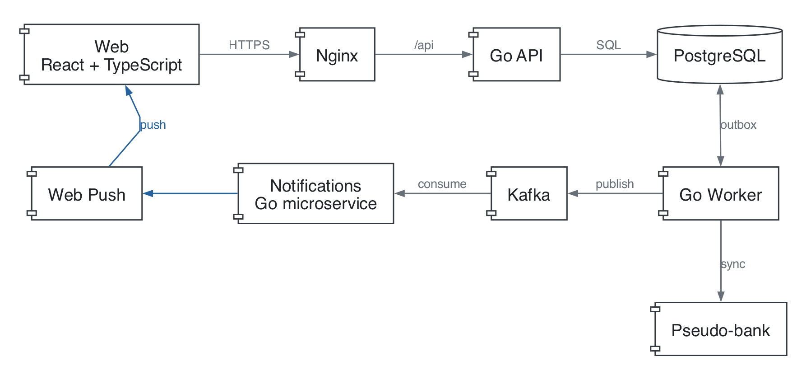

# Архитектура

Пересборка схемы из корня с Graphviz: `dot -Tpng docs/diagrams/architecture.dot -o docs/diagrams/architecture.png`.

На backend реализованы регистрация и вход по email/паролю, JWT-сессии и демо Web Push. Есть базовые таблицы `users`, `auth_sessions`, `ledger_periods`, `audit_log` и основа хранения операций (`bank_connections`, `transactions`). Финансовые модули и импорт ниже описывают план.

## Стек

- Backend: Go, `net/http`, PostgreSQL, pgx, sqlc, goose.
- Фоновые задачи: worker публикует outbox; импорт будет добавлен позже.
- Push-уведомления: отдельный Go-сервис `notifications`, Kafka через franz-go, Web Push.
- Frontend: React, TypeScript, Vite, CSS, `fetch`.
- Локальный запуск: Docker Compose; nginx раздаёт frontend и проксирует `/api/`.

Проект состоит из одного Go-модуля и трёх отдельных процессов: API, worker и `notifications`.

API обрабатывает пользовательские запросы, worker публикует события в Kafka, а `notifications` независимо отправляет push-уведомления.

Основные модули backend: пользователи, бюджет, операции, правила, цели и уведомления. Источник банковских операций на первом этапе — локальный mock API.

SQL сервисов хранится в `backend/queries/`, отдельно для API, outbox и notifications. sqlc генерирует типизированные методы pgx в `backend/internal/db/` по goose-миграциям. Транзакциями управляют сервисы, передавая `pgx.Tx` в сгенерированный пакет.

## Авторизация (TODO: переписать)

## Данные и события (TODO: переписать)